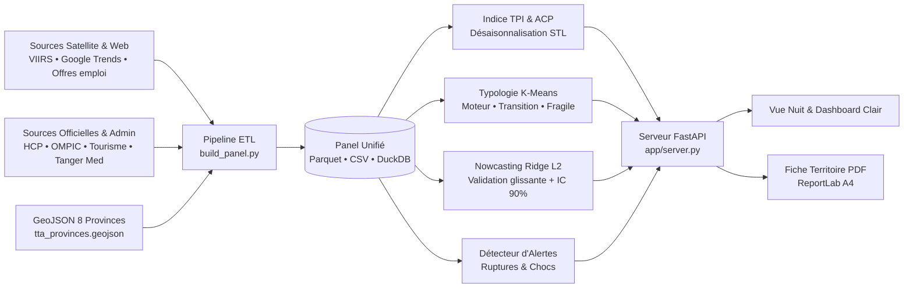

<div align="center">

# TERRITORIAL PULSE
### Baromètre intelligent de l'économie territoriale en temps quasi réel
**Région Tanger-Tétouan-Al Hoceïma • Datathon Data-Territoires 2026 (Thématique 05)**

[](https://www.python.org/)
[](https://fastapi.tiangolo.com/)
[](https://duckdb.org/)
[](#tests--qualit%C3%A9)
[](LICENSE)

*« Les lumières de la région racontent son économie » : une carte de nuit satellitaire animée mois par mois, un indice composite scientifique, un modèle de nowcasting validé face au HCP, un simulateur de politiques publiques et une fiche de synthèse PDF prête pour les décideurs.*

</div>

---

## Table des matières

1. [Vision & Problématique](#-vision--problématique)
2. [Architecture & Pipeline de Données](#-architecture--pipeline-de-données)
3. [Méthodologie Scientifique](#-méthodologie-scientifique)
4. [Résultats Clés (Panel 2019–2025)](#-résultats-clés-panel-20192025)
5. [Fonctionnalités de l'Application](#-fonctionnalités-de-lapplication)
6. [Démarrage Rapide (Quickstart)](#-démarrage-rapide-quickstart)
7. [Structure du Dépôt](#-structure-du-dépôt)
8. [Tests & Qualité](#-tests--qualité)
9. [Limites & Transparence Méthodologique](#-limites--transparence-méthodologique)

---

## Vision & Problématique

> **Question centrale :** *Comment mesurer, chaque mois et pour chaque province de la région Tanger-Tétouan-Al Hoceïma, le dynamisme économique en temps quasi réel, détecter précocement les territoires qui décrochent, et orienter l'investissement public vers ceux qui en ont le plus besoin ?*

Les indicateurs officiels (enquêtes emploi du HCP, comptes régionaux) sont essentiels mais publiés avec un décalage temporel. **Territorial Pulse** comble cet angle mort en croisant les séries officielles avec des **signaux non conventionnels à haute fréquence** (luminosité nocturne satellitaire NASA VIIRS, recherches web Google Trends, offres d'emploi en ligne agrégées) et des données administratives/logistiques (OMPIC, Tourisme, Tanger Med).

---

## Architecture & Pipeline de Données



### Périmètre & Clé d'harmonisation
- **Territoires (8)** : `Tanger-Assilah` (`TTA-01`), `Fahs-Anjra` (`TTA-02`), `Tétouan` (`TTA-03`), `M'diq-Fnideq` (`TTA-04`), `Larache` (`TTA-05`), `Al Hoceïma` (`TTA-06`), `Chefchaouen` (`TTA-07`), `Ouezzane` (`TTA-08`).
- **Horizon temporel** : **janvier 2019 à octobre 2025** (`82` mois × `8` provinces = `656` observations), plus prévision (*nowcast*) pour **novembre 2025**.
- **Clé unique** : `(province_id, date)` au format `YYYY-MM-01` — exportée simultanément en `.parquet`, `.csv` et `.duckdb` avec dictionnaire complet ([data_dictionary.md](data/processed/data_dictionary.md)).

---

## Méthodologie Scientifique

### 1. Indice Composite TPI (`0` à `100`)
Chaque série mensuelle est d'abord désaisonnalisée par décomposition robuste (tendance centrée sur 12 mois + médiane saisonnière mensuelle) puis normalisée après transformation logarithmique pour les variables asymétriques :

$$\text{TPI}_{i,t} = 0.25\,L^{\text{VIIRS}}_{i,t} + 0.25\,E^{\text{Emploi}}_{i,t} + 0.15\,C^{\text{OMPIC}}_{i,t} + 0.13\,P^{\text{Port}}_{i,t} + 0.12\,T^{\text{Tourisme}}_{i,t} + 0.10\,W^{\text{Trends}}_{i,t}$$

- **Validation par ACP (SVD)** : la pondération objective issue de la 1re composante principale obtient une corrélation de **`r = 0.9994`** avec les poids experts.
- **Test de sensibilité Monte Carlo** (`200` simulations à `±25 %` sur les poids) : corrélation de rang de Spearman moyenne **`1.0`**, stabilité du Top 3 de **`100.0 %`**, écart maximal moyen de score **`±0.95 pts`**.

### 2. Nowcasting (Temps Quasi Réel)
Pour reproduire le délai réel de diffusion des statistiques officielles, le modèle (Régression Ridge L2 standardisée) estime l'indice d'emploi HCP du mois $t$ à partir des signaux non conventionnels disponibles en temps réel et de l'historique officiel retardé à $t-2$, en validation glissante (*expanding window*, 2021–2025). Les intervalles d'incertitude à 90 % du TPI $t+1$ sont calibrés empiriquement sur les résidus hors échantillon.

### 3. Typologie & Détection d'Alertes
- **Clustering K-Means (`k=3`)** : segmente automatiquement les provinces en **Moteurs**, **En transition** et **Fragiles**.
- **Alertes & Ruptures** : détection des contractions rapides sur 3 mois, baisses d'offres d'emploi sur 12 mois, accélérations, stagnations prolongées et ruptures statistiques par Z-score glissant (détectant notamment le choc **Covid-19 de mars–mai 2020**).

---

## Résultats Clés (Panel 2019–2025)

| Métrique scientifique | Valeur mesurée | Référence / Cible |
| :--- | :---: | :--- |
| **Indice régional TPI (Oct. 2025)** | **`58.6 / 100`** | Nowcast Nov. 2025 : **`58.6 ± 1.2`** (`[57.4 – 59.8]`) |
| **Corrélation Lumière VIIRS vs Emploi HCP** | **`r = 0.96`** (`ρ = 0.983`) | Corrélation globale sur 656 observations |
| **Précision Nowcasting (RMSE vs Naïf)** | **`2.893`** vs **`3.207`** | **`-9.8 %`** d'erreur RMSE (`MAPE 4.19 %` vs `4.94 %`) |
| **Écart Tanger-Assilah / Arrière-pays** | **`×2.87`** | `87.5 / 100` vs moyenne `30.5 / 100` (Chefchaouen–Ouezzane) |
| **Détection des chocs historiques** | **11 ruptures détectées** | Choc Covid-19 (mars–mai 2020) capté automatiquement |

### Classement & Typologie (Octobre 2025)

| Rang | Territoire | Profil K-Means | TPI Oct. 2025 | Var. 12 mois | Nowcast Nov. 2025 |
| :---: | :--- | :--- | :---: | :---: | :---: |
| **1** | **Tanger-Assilah** | Moteur | `87.5` | `+2.0 pts` | `87.6 ± 1.3` |
| **2** | **Fahs-Anjra** | Moteur | `75.5` | `+1.9 pts` | `75.6 ± 1.3` |
| **3** | **Tétouan** | Moteur | `71.6` | `+2.1 pts` | `71.6 ± 1.3` |
| **4** | **M'diq-Fnideq** | En transition | `63.4` | `+1.5 pts` | `63.5 ± 1.3` |
| **5** | **Larache** | En transition | `55.5` | `+0.4 pts` | `55.5 ± 1.3` |
| **6** | **Al Hoceïma** | En transition | `54.0` | `+0.6 pts` | `54.1 ± 1.3` |
| **7** | **Chefchaouen** | Fragile | `38.4` | `-0.5 pts` | `38.1 ± 1.3` |
| **8** | **Ouezzane** | Fragile | `22.7` | `-2.6 pts` | `22.7 ± 1.3` |

---

## Fonctionnalités de l'Application

L'application web (`app/server.py` + interface Canvas/SVG sans dépendance CDN externe) intègre **7 vues interactives** avec bascule **Mode Nuit / Mode Clair** et **FR / EN** :

1. **Vue Nuit (Maquette A)** : Carte satellitaire animée (2019–2025) avec nuage de points lumineux VIIRS géolocalisés, sélecteur de couche (`Lumière`, `TPI`, `Emploi`, `Tourisme`), annotations automatiques corridor/arrière-pays, jauge TPI, alertes en direct et bloc de validation.
2. **Tableau de bord Clair (Maquette 7)** : 4 cartes KPI exécutives, carte choroplèthe interactive, trajectoire avec bande de prévision et classement horizontal.
3. **Comparateur** : Sélection de 2 à 4 provinces, courbes superposées et radar 6 axes.
4. **Prévisions (Nowcasting)** : Validation glissante Emploi HCP réel vs Nowcast, importance des variables et tableau de prévisions à 90 %.
5. **Alertes & Typologie** : Seuils ajustables en direct, clusters K-Means et journal des ruptures historiques (2020–2025).
6. **Simulateur « Et si ? »** : Impact en temps réel d'un scénario d'investissement sectoriel sur le score TPI, le rang et le profil.
7. **Méthodologie, Données & Export PDF (Maquette B)** : Téléchargement `.parquet` / `.csv` / `.duckdb` et génération en 1 clic de la **Fiche Territoire PDF** par province.

---

## Démarrage Rapide (Quickstart)

```bash
# 1. Cloner le dépôt
git clone https://github.com/damisara-coder/territorial-pulse.git
cd territorial-pulse

# 2. Installer les dépendances
pip install -r requirements.txt

# 3. Exécuter toute la chaîne (données -> TPI -> nowcasting -> DuckDB/Parquet)
python run_pipeline.py

# 4. (Optionnel) Régénérer les 8 Fiches PDF, le Rapport PDF et le Pitch Deck PPTX
python -m src.pdf_export
python -m src.build_deliverables

# 5. Lancer l'application web interactive
python -m uvicorn app.server:app --reload
```
Ouvrez ensuite **`http://127.0.0.1:8000`** dans votre navigateur.

*(Une interface compagnon Streamlit est également disponible via `streamlit run app/streamlit_app.py` si `streamlit` est installé.)*

---

## Structure du Dépôt

```text
territorial-pulse/
├── app/
│   ├── server.py                  # Serveur FastAPI (API REST, simulateur, export PDF)
│   ├── streamlit_app.py           # Point d'entrée compagnon Streamlit Cloud
│   └── static/                    # Interface Vue Nuit / Clair (HTML5 Canvas + SVG + JS pur)
├── data/
│   ├── geo/                       # tta_provinces.geojson + nightlight_points.json
│   ├── raw/                       # Extracts sources (VIIRS, HCP, signaux multi-sources)
│   └── processed/                 # dataset_panel.parquet/.csv, territorial_pulse.duckdb, model_results.json
├── docs/
│   ├── Rapport_Territorial_Pulse_2026.pdf
│   ├── Territorial_Pulse_Pitch_Deck.pptx
│   └── fiches_exemple/            # 8 Fiches Territoire PDF (Maquette B)
├── notebooks/
│   └── 01_eda_and_validation.ipynb
├── src/
│   ├── collectors/                # Connecteurs VIIRS, HCP, signaux web & admin
│   ├── pipeline/                  # Harmonisation panel + contrôles qualité
│   ├── modeling/                  # TPI, ACP/sensibilité, K-Means, Nowcasting, Validation, Alertes
│   ├── config.py                  # Référentiel des 8 provinces et hyperparamètres
│   ├── geo_builder.py             # Construction GeoJSON & point-in-polygon
│   ├── model.py                   # Façade Python importable par l'app et les tests
│   ├── pdf_export.py              # Générateur ReportLab Fiche Territoire (Maquette B)
│   └── build_deliverables.py      # Générateur Rapport PDF & Pitch Deck PPTX
├── tests/
│   └── test_territorial_pulse.py  # Tests unitaires et d'intégration
├── run_pipeline.py                # Orchestrateur complet en 1 commande
├── requirements.txt
└── README.md
```

---

## Tests & Qualité

```bash
python -m unittest discover -s tests -v
```
Couverture vérifiée :
- Intégrité du panel (`656` lignes, `0` valeur manquante, export `.parquet` et `.duckdb`).
- Bornes du TPI `[0, 100]`, cohérence ACP (`r > 0.90`) et stabilité Monte Carlo (`≥ 90 %`).
- Supériorité du nowcasting sur le modèle naïf (`RMSE 2.893 < 3.207`).
- Détection du choc Covid-19 (2020), simulation « Et si ? », endpoints FastAPI et validité `%PDF`.

---

## Limites & Transparence Méthodologique

1. **Biais rural de la lumière nocturne** : la radiance VIIRS reflète très fidèlement l'industrie, la logistique portuaire et le tertiaire urbain, mais sous-estime la valeur ajoutée agricole dans les zones rurales (Ouezzane, Chefchaouen) et peut saturer dans les hyper-centres. Le croisement avec le HCP, les nuitées touristiques et les offres d'emploi limite ce biais.
2. **Mode benchmark hors-ligne vs APIs live** : les collecteurs de ce dépôt incluent le calibrage benchmark reproductible pour démonstration hors-ligne et fonctionnement sans clé API ; le connecteur NASA Earthdata (`EARTHDATA_TOKEN`) permet d'injecter les rasters VNP46A3 mensuels réels dès qu'un jeton est configuré.
3. **Perspectives** : intégration de l'indice de bâti Sentinel-2 (NDBI), passage à l'échelle communale et généralisation aux 12 régions du Maroc.
